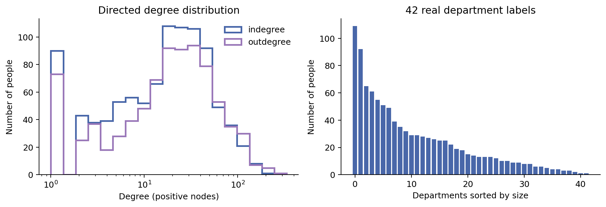
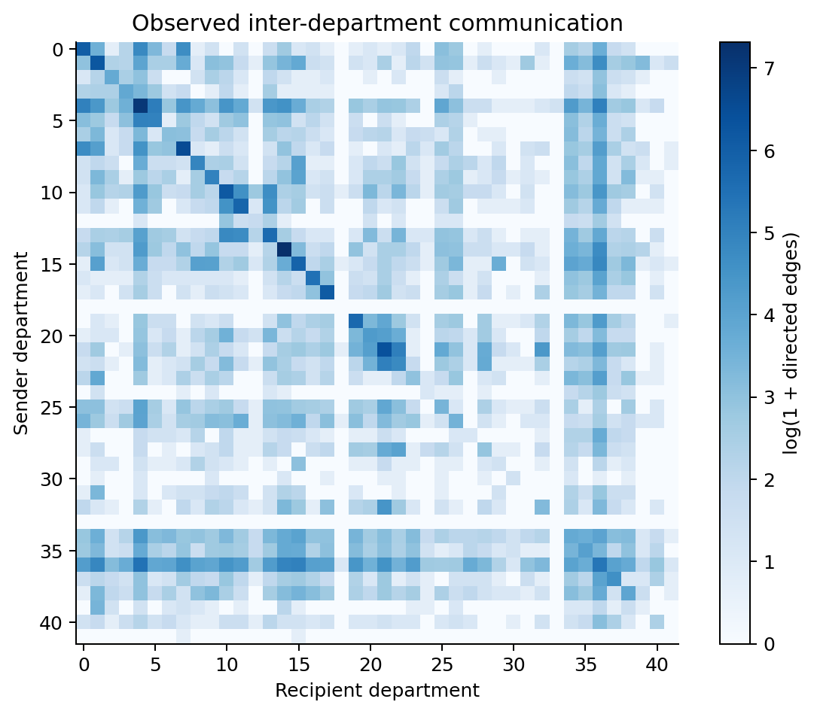
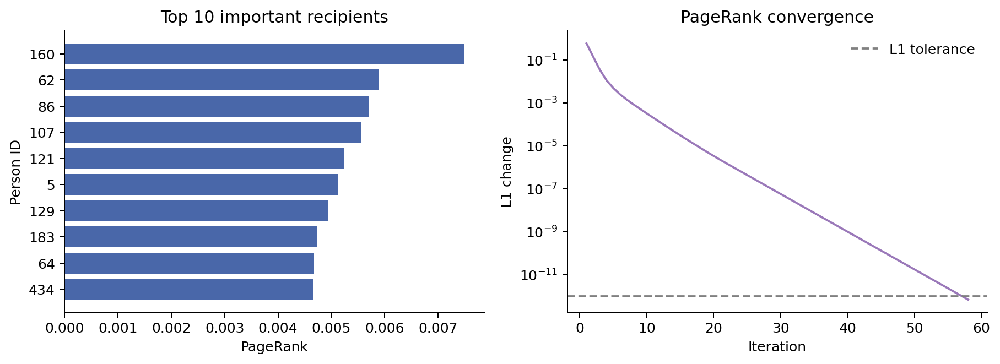
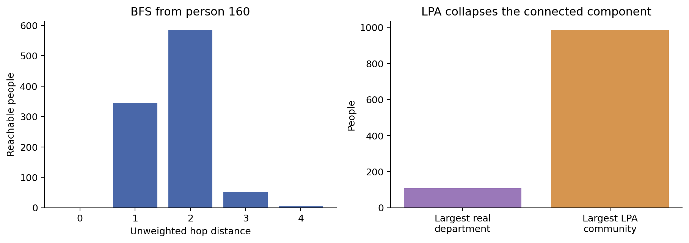
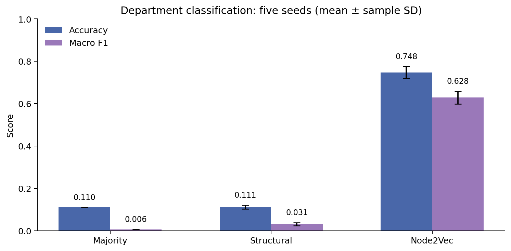
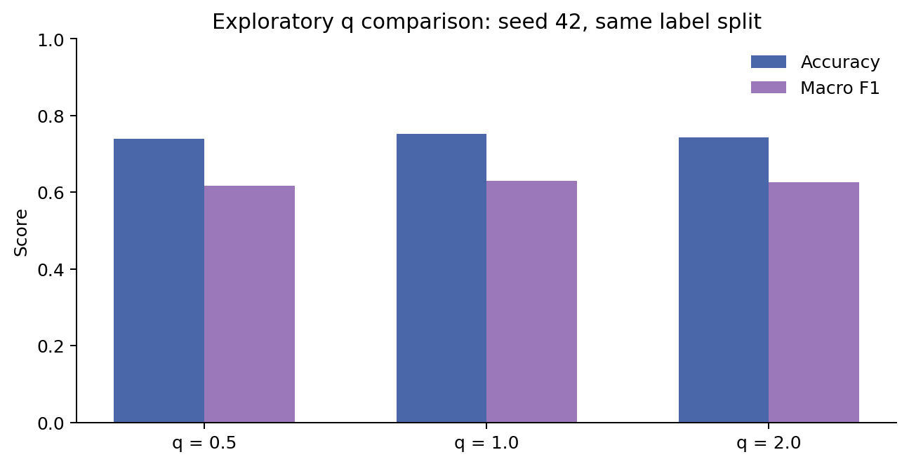
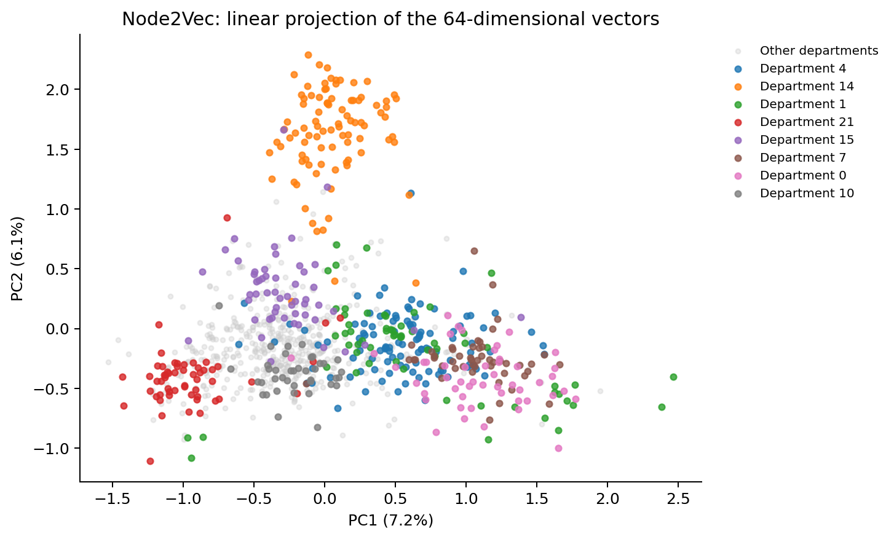

# 基于 TuGraph 的真实邮件网络图查询与图算法实验报告

专业综合实践 · 实验2 · GitHub账号：Ruinan-Li · 整理日期：2026-10-30

[下载17页PDF](report/TuGraph_Lab2_Report.pdf) · [查看发布说明与复现限制](PUBLICATION_NOTE.md)

> 本报告基于已完成的真实TuGraph运行，未使用模拟数据。当前公开文件包括报告、7张原始图表、代码摘录及从原PDF转录的汇总表。会话中断后的工作区清理导致部分未上传源码和原始日志无法恢复，**本分支不是完整的一键复现包**。下文对实验执行过程的描述不等于所有原始输出均已交付，具体留存状态见发布说明。

## 摘要

实验采用Stanford SNAP发布的email-Eu-core真实邮件通信网络，在TuGraph 4.5.2上完成属性图建模、数据导入、Cypher查询、增删改查、中心性计算、图遍历、社区检测和节点嵌入。原始关系文件包含25,571行，超过课程公开数据不少于1万行的要求。清洗删除642条自环，保留全部1,005个节点和24,929条有向关系。

PageRank、BFS、标签传播和Node2Vec偏置随机游走通过TuGraph内C++存储过程运行。客户端基于真实游走序列训练64维Skip-gram向量，使用真实部门标签进行传导式节点分类。五组种子的Node2Vec平均Accuracy为0.7478、Macro-F1为0.6285，Accuracy比五维结构基线高63.64个百分点。标签传播把最大连通分量合并为单一社区，报告保留并分析了这一负面结果。

## 1. PPT要求与实验范围

课程PPT第2页要求：选择满足规模要求的数据集，说明来源、功能和结构；基于TuGraph完成图分析；至少使用两种图算法，其中一种必须是节点嵌入；最后提交网页链接或PDF。第3页以后介绍图建模、Cypher、路径、遍历、中心性、社区、相似性与嵌入。

|课程要求|实际完成内容|本报告位置|
|---|---|---|
|公开数据不少于1万行|25,571条真实通信关系|第2节|
|说明数据来源与结构|匿名成员、邮件方向、部门标签及数据边界|第2节|
|TuGraph属性图建模与导入|Person、EMAIL、主键、属性及批量导入|第4节|
|图查询|计数、分组、度排序、部门关系、两跳连接|第5节|
|增删改查|真实节点属性操作、独立子图中的真实关系CRUD|第5节|
|至少两种图算法|PageRank、BFS、异步标签传播、Node2Vec|第6—8节|
|节点嵌入|TuGraph采样、Skip-gram训练、真实部门分类|第8—9节|
|方法与结果|原理、参数、基线、重复实验、图表、局限|第6—13节|

PPT中学习通登记选题、避免与同学重复的流程未核查，不声称已经完成。

## 2. 数据来源、真实性与清洗

### 2.1 原始数据及其含义

数据来自[Stanford SNAP email-Eu-core](https://snap.stanford.edu/data/email-Eu-core.html)。节点表示某欧洲研究机构内部的匿名成员；有向边`u→v`表示成员u至少给成员v发送过邮件。部门文件提供每个成员所属的真实部门编号，共42类。

原始文件不包含姓名、邮件正文或现实身份。单条边不能解释为“只发过一封邮件”；数据没有邮件次数、时间戳、权重或持续时间。部门流量表示有通信关系的成员对数，不是邮件封数。`u→v`与`v→u`是不同关系。

|文件|数据行数|字节数|格式|
|---|---:|---:|---|
|email-Eu-core.txt.gz|25,571|79,754|每行SRC、DST|
|email-Eu-core-department-labels.txt.gz|1,005|2,663|每行NODEID、DEPARTMENT|

实际下载文件的SHA-256：

```text
email-Eu-core.txt.gz
4b47acdb80197b085fe63c819c357ae488131ee904ed93d1b219a68b0f9e245f

email-Eu-core-department-labels.txt.gz
e5abe5b4581a480032a63adcf2576c161785f45692642c6ebb0b1276f0f33669
```

这些校验值对应原压缩包字节，不能用于校验解压后的文本。原包可从官方页面重新下载。

### 2.2 清洗规则

按整数读取两列数据，核验每条边的端点均有真实部门标签，再检查重复有向边、自环和节点覆盖。实际完全重复边为0，自环642条。只从分析图中移除自环，没有人为增加关系，也没有按照模型表现筛选节点或边。

清洗后保留1,005个节点、24,929条有向边。去掉自环后，19个节点没有外部邻居；这些节点仍留在数据库和结构统计中。导入后，原实验从TuGraph逐节点、逐边读取，并将编号、部门属性及边端点集合与预处理源文件核验，检查通过。完整逐项输出未随本次分支留存。

### 2.3 两种图视图

|视图|构建方式|规模|用途|
|---|---|---|---|
|有向图|保留原邮件方向，删除自环|1,005节点，24,929边|流向查询、入出度、PageRank、部门关系统计|
|无向投影|任意方向有通信即相邻，合并重复无向对|1,005节点，16,064边|BFS、标签传播、Node2Vec|

无向投影在存储过程的邻接结构中生成，不修改数据库原始方向。两种视图边数不同源于建模口径，不能解释为导入丢失。

## 3. 环境与执行流程

|项目|实际环境|
|---|---|
|数据库|TuGraph 4.5.2|
|客户端Python|3.12.14|
|平台|Linux-6.18.57-x86_64-with-glibc2.41，CPU|
|TuGraph二进制编译时Python|3.6.9，与客户端环境分离|
|监听地址|127.0.0.1|
|端口|HTTP 7070、RPC 9090、Bolt 7687|
|实际接口|REST提交Cypher与存储过程请求|
|主子图|email_eu_lab2_20261030|
|执行记录中的UTC时间|2026-10-30T06:46:45.060080+00:00|

数据库开启认证，口令由环境变量传入，不将用户口令或JWT写入交付文件。CRUD删除操作在独立实验子图完成。

完整执行顺序为：下载与校验 → 清洗CSV → 建立Schema → 先导节点后导边 → Cypher查询 → 注册只读C++存储过程 → 图算法与Node2Vec采样 → 客户端训练与分类 → 独立核验 → 回写属性并读回确认 → 绘图与报告。

配套`ceshi_node2vec.py`通过只读事务和出边迭代器生成偏置随机游走，输出的是访问序列而不是向量。本次将数据库读取和采样扩展为C++存储过程，支持整图及固定种子，并补充训练和评估。这样也避免直接将Python 3.6扩展装入Python 3.12客户端造成ABI不兼容。

图输入来自`GraphDB.CreateReadTxn()`、顶点与边迭代器。PageRank、BFS、标签传播和随机游走实际在TuGraph服务进程内运行；NetworkX用于独立校验和辅助统计，Gensim用于客户端向量训练。不能把Gensim时间算作TuGraph内训练时间。

## 4. 属性图建模与导入

|元素|字段/约束|类型|含义|
|---|---|---|---|
|Person|person_id，主键|INT64|SNAP匿名成员编号|
|Person|department|INT32|真实部门，作为查询属性和评估标签|
|Person|note，可空|STRING|属性增删改实验|
|Person|pagerank，可空|DOUBLE|计算后回写的中心性|
|Person|community，可空|INT64|seed=42社区标签|
|EMAIL|Person→Person|有向边|观察到的邮件通信|

EMAIL没有权重字段，因为源数据没有通信次数。`person_id`是业务主键，TuGraph内部VID是存储编号。实现建立VID与连续数组下标的映射，输出时还原person_id，未假定二者相等。

使用`db.importor.schemaImportor`建立Schema，`db.importor.dataImportor`批量导入。先导入节点，后导入关系；CSV有表头，设置`header=1`，并使用`continue_on_error=false`。TuGraph 4.5.2接口需要Base64编码的描述与数据内容。

```python
# 原报告中的导入调用片段；enc、file_spec、csv_path及client由原完整程序提供。
description = json.dumps({"files": [file_spec]})
content = csv_path.read_text()
query = (
    "CALL db.importor.dataImportor("
    f"'{enc(description)}','{enc(content)}',false,1,',')"
)
client.cypher(query)
```

## 5. Cypher查询与增删改查

以下语句均来自已执行实验的报告。摘录另见[report_queries.cypher](code/report_queries.cypher)。原始查询响应未全部恢复，此处保留报告中已经展示的结果。

### 5.1 计数与分组

```cypher
MATCH (n:Person) RETURN count(n) AS persons;
MATCH (:Person)-[r:EMAIL]->(:Person) RETURN count(r) AS emails;
MATCH (n:Person)
RETURN n.department AS department, count(n) AS persons
ORDER BY persons DESC;
```

前两条分别返回1,005和24,929。部门聚合返回42行。Cypher的非聚合返回字段充当分组键，不需要显式`GROUP BY`。

### 5.2 出度、入度与部门通信

```cypher
MATCH (p:Person)-[:EMAIL]->(q:Person)
RETURN p.person_id AS person_id, p.department AS department,
       count(q) AS degree
ORDER BY degree DESC, person_id LIMIT 10;

MATCH (p:Person)-[:EMAIL]->(q:Person)
WHERE p.department <> q.department
RETURN count(*) AS cross_department_edges;
```

|节点|部门|出度|
|---:|---:|---:|
|160|36|333|
|82|36|226|
|121|36|221|
|107|36|203|
|86|36|201|
|62|36|189|
|13|26|171|
|249|14|159|
|183|4|158|
|434|34|156|

出度是不同收件人数，入度是不同发件人数。跨部门关系16,284条，部门内8,645条。排序中加入person_id，使同度数时的次序明确。

### 5.3 两跳连接

```cypher
MATCH (p:Person {person_id:0})-[:EMAIL]->(q:Person)-[:EMAIL]->(r:Person)
WHERE p.person_id <> r.person_id
RETURN r.person_id AS person_id, count(DISTINCT q) AS intermediaries
ORDER BY intermediaries DESC, person_id LIMIT 10;
```

|目标节点|不同中介数|
|---:|---:|
|74|20|
|215|19|
|221|18|
|17|17|
|223|17|
|86|16|
|177|15|
|218|15|
|1|14|
|222|14|

此查询没有排除一跳邻居，因此只是两跳可达与中介数量分析，不能直接称为新增联系人推荐。

### 5.4 CRUD

在主图对真实节点0设置`note='Lab 2 verification'`，查询确认后使用`REMOVE`清空可空属性。另建独立CRUD子图，从原数据取第一条真实边及两个真实端点，执行创建、删除关系、删除节点，最终核验节点和边均为0。没有构造虚假人员或虚假通信关系。

```cypher
MATCH (p:Person {person_id:0})
SET p.note='Lab 2 verification' RETURN p.person_id,p.note;
MATCH (p:Person {person_id:0})
REMOVE p.note RETURN p.person_id,p.note;
```

独立CRUD子图中使用的删除语句为`MATCH (a)-[r:EMAIL]->(b) DELETE r;`及`MATCH (n) DELETE n;`。这些语句不应在主分析图执行。`DELETE`删除实体，`REMOVE`删除属性。

## 6. 网络结构与PageRank

### 6.1 结构统计

|指标|结果|
|---|---:|
|节点数|1,005|
|有向边数|24,929|
|无向投影边数|16,064|
|弱连通分量数|20|
|最大弱连通分量|986|
|强连通分量数|203|
|最大强连通分量|803|
|孤立节点数|19|
|有向密度|0.024706|
|有向互惠率|0.711220|
|无向平均聚类系数|0.399355|



正度数分布用于展示连接差异，但19个孤立点仍在全图统计中。部门规模不均衡，需要同时报告Accuracy和Macro-F1。互惠率表示有向边中有反向边对应的比例，不是邮件回复率。最大弱连通分量包含986人，其他19个分量都是孤立点。



图中行是发送方部门、列是接收方部门，颜色使用`log(1+关系数)`。它没有按部门人数归一化，大部门的高关系数可能受到规模影响。跨部门关系占65.32%，可能促使简单标签传播合并成大社区，但不能单凭该比例证明退化原因。

### 6.2 PageRank方法

在有向图中，每轮将发件节点得分按出度均分给接收节点，并加入均匀随机跳转。参数为`alpha=0.85`，初值`1/N`，悬挂节点分数均分给全部节点。更新式为：

```text
PR_new(v) = (1-alpha)/N + alpha*dangling_mass/N
          + alpha * sum(PR(u)/outdegree(u))
```

求和范围为指向v的节点u。相邻两轮分数的L1差小于`1e-12`停止，最多500轮。复杂度约`O(K(N+M))`。部门标签不参与计算。

实际58轮收敛，最终L1变化`6.984e-13`，概率和`1.000000000000`。与独立NetworkX实现的最大绝对误差`2.203e-13`。

|排名|节点|部门|PageRank|入度|出度|
|---:|---:|---:|---:|---:|---:|
|1|160|36|0.00749615|211|333|
|2|62|36|0.00589415|178|189|
|3|86|36|0.00570852|153|201|
|4|107|36|0.00556441|168|203|
|5|121|36|0.00523139|156|221|
|6|5|25|0.00511705|123|155|
|7|129|4|0.00494818|138|135|
|8|183|4|0.00472662|142|158|
|9|64|25|0.00467315|135|112|
|10|434|34|0.00465310|150|156|



PageRank与入度的Spearman相关系数为0.982871。最高分节点为160，但匿名编号只支持结构位置分析，不能推断行政级别或绩效。得分实际回写到`Person.pagerank`，并通过Cypher读回确认。

## 7. BFS与标签传播

### 7.1 BFS

以节点160为起点，在无向投影上使用队列广度优先遍历，首次访问时记录距离与父节点。得到的是无权图中的最少边数路径，复杂度`O(N+M)`。

|距离|节点数|
|---:|---:|
|0|1|
|1|345|
|2|585|
|3|51|
|4|4|

总共可达986个节点。一条实际最短路径为`160 → 27 → 370 → 414 → 449`，长度4条边。此处是无向通信距离，不是邮件转发方向，也不能将此起点的最大距离称为全图直径。原实验逐节点与NetworkX单源最短路核验一致。

### 7.2 异步标签传播

每个节点初始具有不同标签；每轮随机打乱访问顺序，选取邻居中最高频标签并立即更新。若当前标签在并列最高频候选中，保留当前标签；否则随机选择最高频候选。全部标签不再改变时停止，最多100轮。孤立点保留各自标签。真实部门不参与更新。

|种子|社区数|最大社区|迭代轮数|模块度|NMI|ARI|
|---:|---:|---:|---:|---:|---:|---:|
|11|20|986|6|0.000000|0.032919|-0.000732|
|23|20|986|6|0.000000|0.032919|-0.000732|
|42|20|986|6|0.000000|0.032919|-0.000732|
|71|20|986|4|0.000000|0.032919|-0.000732|
|101|20|986|7|0.000000|0.032919|-0.000732|



五次均将全部986个非孤立节点合并为一个社区，另19个社区各为孤立点。“20个社区”不代表识别出20个有效业务社区。模块度0、NMI约0.033，不能认为恢复了部门结构。ARI可以为负，它是经随机一致性校正的指标，不代表计算错误。

真实部门在同一无向图上的模块度为0.288013，说明图中仍有部门相关结构。此负面结果提示：收敛只表示停止，不保证划分有解释力。Louvain、Leiden或带分辨率约束的方法可作为后续研究，但本实验未运行，不能列入实测结果。

## 8. Node2Vec节点嵌入

### 8.1 从游走到向量

原Python样例只对一个起点产生序列。本实验遍历全部非孤立节点，固定种子，每节点10次、每次40节点，使用去重无向邻接，检查参数并保存结构化输出，再进行Skip-gram和分类。

第一次从起点邻居中均匀采样；其后，令上一节点为t、当前为v、候选邻居为x，转移权重为：

|候选情况|未归一化权重|
|---|---:|
|x=t，立即返回|1/p|
|x与t相邻|1|
|其他|1/q|

在当前节点的候选邻居上归一化后采样。p大抑制立即返回；q小于1增加向更远处探索的相对权重；q大于1偏向局部。所有邻接均来自真实图。随机数服务于算法采样和模型训练，没有用于生成虚构网络记录。

```cpp
weight = (x == previous) ? 1.0 / p
    : (adjacent(previous, x) ? 1.0 : 1.0 / q);
next = neighbors[discrete_distribution(weights)(rng)];
```

### 8.2 参数

|参数|设置|
|---|---|
|起点|986个非孤立节点|
|游走次数/长度|每节点10次，每次40个节点|
|主实验|p=1，q=0.5|
|随机种子|11、23、42、71、101|
|q对照|seed=42，q=1及2|
|每配置语料|9,860条游走，394,400个token|
|向量维数|64|
|目标|Skip-gram + negative sampling|
|window / negative|5 / 5|
|epochs / min_count|10 / 1|
|sample|0.001|
|workers|1|
|稳定初始化|固定seed，SHA-256 token哈希|
|分类器|StandardScaler + LogisticRegression(C=1,max_iter=2000)|

共训练7个配置。原验证检查所有步长均对应真实边、每条长度和每起点次数正确、986个节点均具有有限的64维向量。19个孤立点没有被填入随机向量，也没有生成重复token伪语料。跨编译器、BLAS或库版本不保证位级一致。

```python
model = Word2Vec(
    sentences=walks_as_tokens, vector_size=64, window=5,
    min_count=1, sg=1, hs=0, negative=5, sample=1e-3,
    workers=1, epochs=10, seed=seed, hashfxn=stable_hash
)
```

负采样是训练目标中的抽样机制，不代表虚构观察边。部门标签不进入游走转移、词表构建或嵌入训练。[训练调用摘录](code/node2vec_training_excerpt.py)依赖原程序提供的输入，不是完整可执行流程。

### 8.3 评估协议

任务为根据图结构预测真实部门。完整图拓扑对无监督训练可见，只有训练节点的部门标签用于监督分类，属于**传导式节点分类**，不代表预测未见新节点或未来邮件。

预先排除孤立点及非孤立成员少于5人的部门；纳入968个节点、35个部门，排除37个节点。每个种子进行70%/30%分层划分，实际677训练、291测试。同一种子各基线使用同一拆分，标准化器只拟合训练节点。测试标签不用于嵌入、标准化、监督拟合或参数选择；C固定为1。

|方法|特征和预测方式|
|---|---|
|Majority|恒预测训练集中最多的部门|
|Structural|log(1+入度)、log(1+出度)、log(1+无向度)、PageRank、局部聚类系数|
|Node2Vec|64维嵌入|

后两者使用相同标准化和分类器。Accuracy为正确率，Macro-F1对部门等权平均，Weighted-F1按测试部门规模加权。单标签多分类中的Micro-F1等于Accuracy，未重复报告。

## 9. 分类、参数对照及相似性结果

### 9.1 五组种子

以下数值沿用原PDF四位小数，结构化版本见[classification_metrics_reported.csv](results/classification_metrics_reported.csv)。

|种子|方法|Accuracy|Macro-F1|Weighted-F1|
|---:|---|---:|---:|---:|
|11|Node2Vec|0.7938|0.6781|0.7872|
|11|Structural|0.1100|0.0276|0.0547|
|11|Majority|0.1100|0.0057|0.0218|
|23|Node2Vec|0.7491|0.6320|0.7402|
|23|Structural|0.1203|0.0390|0.0713|
|23|Majority|0.1100|0.0057|0.0218|
|42|Node2Vec|0.7388|0.6176|0.7291|
|42|Structural|0.1134|0.0280|0.0576|
|42|Majority|0.1100|0.0057|0.0218|
|71|Node2Vec|0.7216|0.6141|0.7224|
|71|Structural|0.1168|0.0380|0.0677|
|71|Majority|0.1100|0.0057|0.0218|
|101|Node2Vec|0.7354|0.6007|0.7330|
|101|Structural|0.0962|0.0216|0.0500|
|101|Majority|0.1100|0.0057|0.0218|

原报告的均值与样本标准差（ddof=1，n=5）：

|方法|Accuracy|Macro-F1|Weighted-F1|
|---|---|---|---|
|Majority|0.1100 ± 0.0000|0.0057 ± 0.0000|0.0218 ± 0.0000|
|Structural|0.1113 ± 0.0093|0.0308 ± 0.0074|0.0603 ± 0.0089|
|Node2Vec|0.7478 ± 0.0276|0.6285 ± 0.0299|0.7424 ± 0.0259|



Node2Vec平均Accuracy比结构特征基线高63.64个百分点。Macro-F1低于Accuracy，说明小部门或边界节点更难分类。结果只适用于纳入的35个部门，不能外推为全部42部门的准确率。

标准差包含游走、训练和标签拆分同时变化的影响，不是固定测试集的模型随机性。五次拆分共享数据且重叠，不能看作五个独立新数据集。本次未做显著性检验。

### 9.2 q参数探索

固定seed=42、p=1、训练配置和标签拆分，只改变q：

|q|Accuracy|Macro-F1|Weighted-F1|
|---:|---:|---:|---:|
|0.5|0.7388|0.6176|0.7291|
|1.0|0.7526|0.6290|0.7401|
|2.0|0.7423|0.6265|0.7292|



这是单种子探索，不参与主参数选择，也不足以确定通用最优q。进一步调参需要独立验证集，不能利用此测试结果选参后再重报同一测试分数。

### 9.3 向量可视化与相似节点



图为seed=42、q=0.5的64维向量经PCA降到二维。突出显示人数最多的8个部门，其余为灰色。标签只用于着色，PCA不使用标签。二维降维会丢失高维信息，视觉分离或重叠不能替代分类评估。

节点160的五个余弦最近邻如下。“已有边”按无向投影判断。

|相似节点|部门|余弦相似度|同部门|已有边|
|---:|---:|---:|---|---|
|166|36|0.5478|是|是|
|62|36|0.5463|是|否|
|107|36|0.5411|是|是|
|533|35|0.5329|否|是|
|301|26|0.5212|否|否|

这些节点中有些本来就相连，因此这里只是相似性分析，不是经过留边测试的链接预测。

## 10. 实际耗时与校验

### 10.1 时间口径

存储过程分别记录读图/构建邻接耗时和算法/结果对象构造耗时；客户端时间还包括REST、序列化及解析。以下均为此次运行的一次测量，不能作为数据库间性能比较。Node2Vec数据库时间不包括Gensim训练。

|任务|种子/q|读图秒|算法秒|客户端秒|
|---|---|---:|---:|---:|
|PageRank|—|0.005561|0.002579|0.015849|
|BFS|—|0.004281|0.000126|0.007814|
|LPA|11|0.005160|0.004126|0.012830|
|Node2Vec|11/0.5|0.004613|1.037817|1.131058|
|LPA|23|0.004459|0.003321|0.011752|
|Node2Vec|23/0.5|0.006833|1.299578|1.411911|
|LPA|42|0.004760|0.003068|0.012189|
|Node2Vec|42/0.5|0.004908|1.226558|1.332183|
|LPA|71|0.005385|0.002319|0.012704|
|Node2Vec|71/0.5|0.004495|1.134434|1.218132|
|LPA|101|0.004502|0.004547|0.014347|
|Node2Vec|101/0.5|0.013024|1.259141|1.361265|
|Node2Vec|42/1.0|0.006355|1.502097|1.597245|
|Node2Vec|42/2.0|0.007301|1.475745|1.565154|

|种子|q|客户端向量训练秒|有效向量数|
|---:|---:|---:|---:|
|11|0.5|26.473|986|
|23|0.5|19.889|986|
|42|0.5|13.103|986|
|71|0.5|13.559|986|
|101|0.5|13.823|986|
|42|1.0|13.049|986|
|42|2.0|12.564|986|

### 10.2 原执行阶段的校验

1. TuGraph节点属性和完整边集合与预处理源数据一致。
2. PageRank概率和接近1，与独立实现最大误差小于1e-9。
3. BFS每个节点距离与独立最短路实现一致。
4. LPA各次收敛，停止时每个当前标签均处于邻居最高频标签集合。
5. 七组游走长度、起点次数与每一步真实邻接检查通过。
6. 所有嵌入元素有限，分类拆分、逐节点预测与指标曾被交叉核验。

上述为原报告记录的检查结果。本次发布只重新核对已恢复PDF/PNG文件、转录表格、文件链接和交付哈希，未重跑数据库，也没有将缺失原始日志当作当前可供独立审核的证据。

## 11. 实现问题与解决

|问题|原实验处理方式|
|---|---|
|依赖旧libgfortran.so.4|解压官方Ubuntu兼容包到独立runtime，通过LD_LIBRARY_PATH加载|
|Boost Geometry WKB扩展缺失|补齐上游扩展，原构建记录固定提交SHA|
|导入接口要求Base64|分别编码Schema描述、导入描述和CSV|
|存储过程装载|用db.plugin.loadPlugin注册SO，声明只读，及时释放读取事务|
|部分UNWIND与属性模式兼容问题|逐个按主键MATCH回写，再经Cypher读回|
|样例只生成游走|补充训练、真实标签评估、基线、五种子及q对照|
|小类别和孤立点妨碍分层评估|预先固定排除规则，明确35类评估范围|

## 12. 交付与复现边界

当前目录实际交付文件以[发布说明](PUBLICATION_NOTE.md)和[SHA256SUMS](SHA256SUMS)为准。代码目录提供的是报告中已有代码片段，不能替代完整存储过程与端到端脚本。原脚本、原日志和部分逐节点输出因中断后清理未能恢复；完整向量的公开上传另被自动审批拒绝。

可据报告重新获取公开数据，并在Linux x86-64、TuGraph 4.5.2环境中重新实现相同流程。应区分有向/无向视图、正确处理VID映射和孤立点，使用原参数及分层评估协议，重新保存数据库返回、模型输入和预测。重实现的运行必须作为新实验记录，不应冒充本次原始输出。

本分支汇总CSV从PDF表格转录，保留原显示精度。四位小数不能恢复完整底层精度，不能据此进行高精度统计复核。

## 13. 结论与局限

实验完成真实数据获取、TuGraph图模型与查询、数据库内图算法、客户端节点表示学习和结果分析。PageRank刻画接收节点的结构重要性，BFS描述无向通信距离，Node2Vec利用多步上下文，在固定协议下明显优于五维结构特征基线。简单标签传播合并为大社区的结果也表明，算法停止和社区可解释性是不同问题。

数据来自单个机构的静态匿名网络，无通信次数和时间；真实部门不必等同于协作社区；分类排除了孤立点及极小类别，且属于传导式任务。q实验只有一个种子，没有独立验证集调参、显著性检验、未来链接预测或数据库性能对照。另有原始附件留存不完整的复现限制。以上均不应被报告中的高分类分数掩盖。

## 14. 参考资料

1. [Stanford SNAP：email-Eu-core](https://snap.stanford.edu/data/email-Eu-core.html)，真实网络与部门标签。
2. [TuGraph v4.5.2 Release](https://github.com/TuGraph-family/tugraph-db/releases/tag/v4.5.2)，实际数据库版本。
3. [TuGraph Cypher API](https://tugraph-db.readthedocs.io/en/latest/8.query/1.cypher.html)，查询与过程接口；实际行为以4.5.2运行结果为准。
4. [TuGraph Stored Procedure Guide](https://tugraph-db.readthedocs.io/en/latest/9.olap%26procedure/1.procedure/1.procedure.html)。
5. Grover A., Leskovec J. [node2vec: Scalable Feature Learning for Networks](https://arxiv.org/abs/1607.00653). KDD, 2016.
6. Raghavan U. N., Albert R., Kumara S. [Near linear time algorithm to detect community structures in large-scale networks](https://arxiv.org/abs/0709.2938). Physical Review E 76, 036106, 2007.
7. Page L., Brin S., Motwani R., Winograd T. [The PageRank Citation Ranking: Bringing Order to the Web](http://ilpubs.stanford.edu:8090/422/).
8. 用户课程PPT《专业综合实践-实验2-图查询与图算法》及配套ceshi_node2vec.py；重点对应PPT第2、5、9—15、17—27页。
